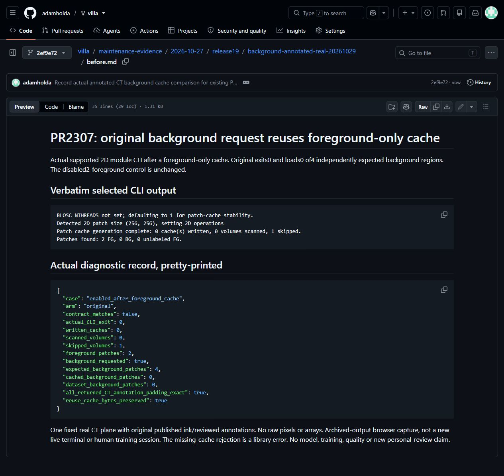
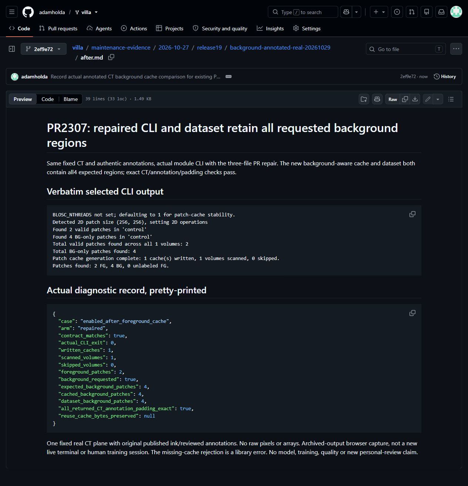
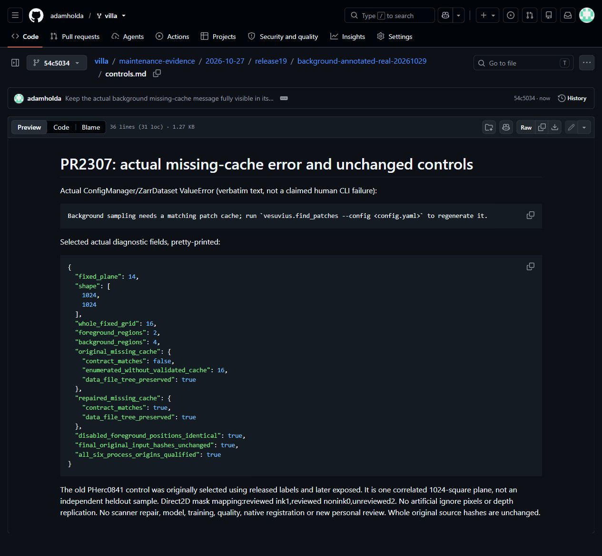

# Authentic annotated CT background cache workflow

Existing [PR2307](https://github.com/ScrollPrize/villa/pull/2307), unchanged production head `f5c5da2b9f01fd4f2ff574bc22656164e948cb6b`. Four actual patch-generation CLI calls and six compound ConfigManager/ZarrDataset records on the whole fixed PHerc0841 CT plane14 and its original published ink/reviewed masks. The original silently reuses a foreground-only cache with0BG instead of4;repair generates and loads all4. Disabled foreground membership remains2. The actual missing-cache library error replaces original unvalidated enumeration. All returned CT/annotation/padding values and original source hashes remain exact.

171allocatedseconds x1CPU/0GPU. RawresultSHA256 `4e235e09c2f146f89c138f474b66302e40a3787bf7fd40eea52fea18362363b4`. Same0142runtime archive/180versions/416non-fiber source closure,actual process-origin controls;not a fresh installer/full-repository proof. One correlated previously exposed control,not6independent samples or an old human incident. Direct2D mapping,not3Dlabels or registration truth;no model/training/quality assertion. Held0043/scanner failures remain excluded and immutable.

- [Original actual CLI and diagnostic fields](before.md)
- [Repaired actual CLI and diagnostic fields](after.md)
- [Actual missing-cache error and controls](controls.md)
- [Selected public-safe fields](selected-fields.json)

These excerpts omit private paths,account/host identifiers,per-job IDs and precise timestamps before capture. Numeric fields and selected CLI lines are unchanged. Screenshots will be unmodified browser captures of these archived views;no live terminal/CT-pixel claim. Original author review is preserved;this new supplement is not presumed personally reviewed. AI assistance was used for implementation,validation orchestration and analysis. Computational resources provided by e-INFRA CZ90254;VillaMIT,CT and original annotation rights/credits remain separate. No new fix/family,adoption,acceptance or prize claim.

## Actual archived-output captures

