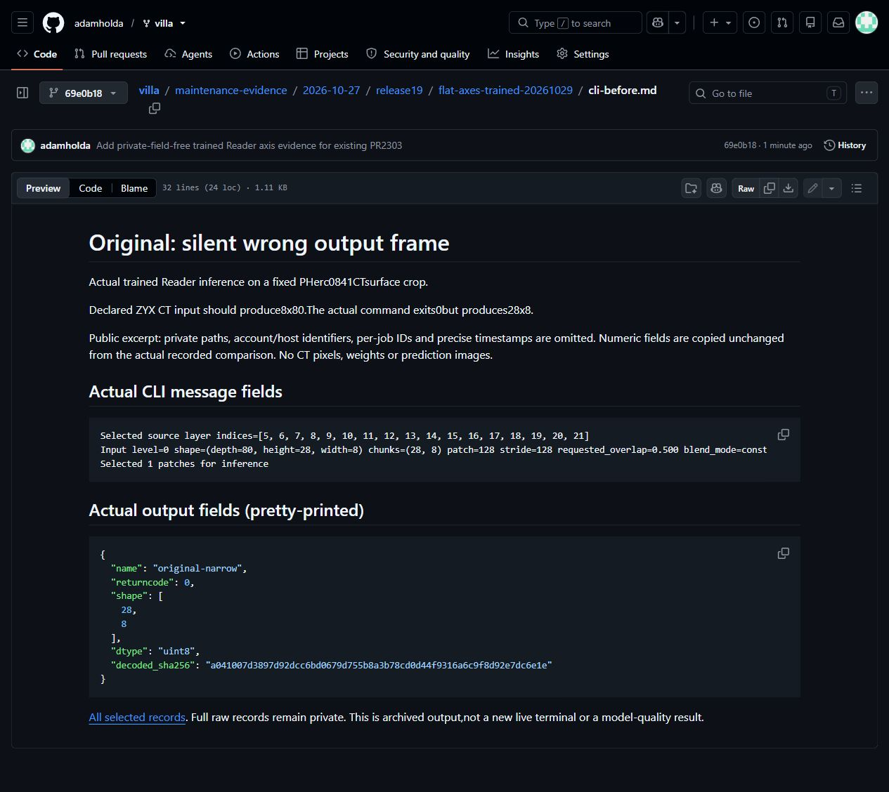
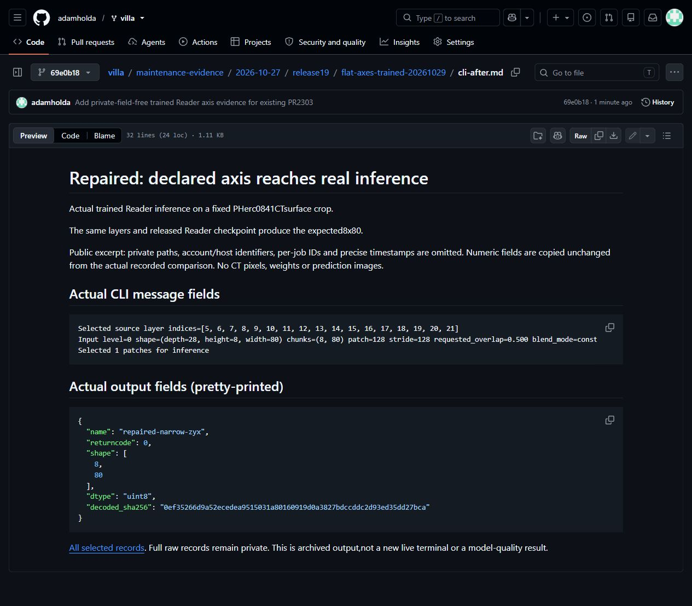
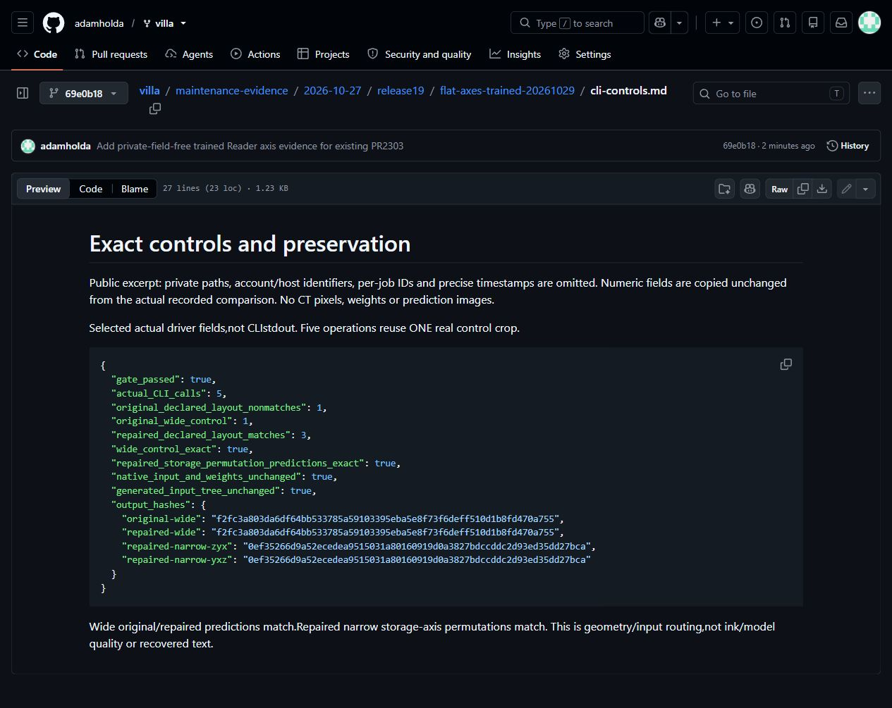

# PR2303: trained Reader axis comparison on real CT

**Complete within stated scope.** Five actual native module CLI calls use the original released Reader v2 and one fixed PHerc0841surface CT control. Original declared-ZYX narrow input silently produces28x8instead of8x80(exit0). Repaired ZYXandYXZ both produce8x80with byte-identical predictions. Wide64x80original/repaired control matches exactly. Full native input/checkpoint and generated-input hashes match after execution.

[Actual before fields](cli-before.md) · [Actual after fields](cli-after.md) · [Exact controls](cli-controls.md) · [Selected numeric records](selected-fields.json).

The actual current strict factory loads34546498parameters,crop17x128x128,and complete configure_single_model uses tifxyz_robust. No recording model or checkpoint metadata rewrite. Only storage axes are permuted in constructed format2containers. Fixed wide crop[0:28,256:320,256:336],narrow first8rows;no label/prediction selection. Actual flags retain layers5:22,batch1,workers0,no compile,forward,constant blend,stride128andCPUAMPauto. Five operations reuse ONE control;not five independent scientific samples.

Exact source head6b4bcd85da5178edead85e5510f6aee056cdacf0 remains unchanged. A verified archive deploys the same180package versions/416non-fiber sources and portableCPython3.14.0;actual command processes pass return-preserving module/library-origin observation. Base interpreter/stdlib remain shared. This is not a fresh installer/full repository/excludedfiber proof. The original failed attempt remains failed;this separate explicitly approved deployed context does not transfer old passes.

Public excerpts omit private paths,account/host identifiers,per-job IDs and precise timestamps. Numeric values are unchanged;CLI message prefixes carrying timestamps and path-bearing lines are omitted explicitly. Full raw logs/accounting remain private. Screenshots are unmodified browser captures of these actual archived field excerpts,not a live terminal or CT pixels. Original author verification covers only the earlier recorded review;no new personal review is inferred.

This is real trained-model geometry/routing evidence,not model/ink quality,heldout performance,throughput,depth/native-registration or recovered letters. Raw CT,weights and prediction TIFFs remain private. Separate occupancy/pyramid/provenance work2127/2256/2282/1891is not included or attributed here. AI assistance:implementation and validation orchestration/analysis;adopted workflow motivation is separately recorded on the PR.

Computational resources:e-INFRA CZproject90254.VillaMIT,Reader model rights and EduceLab-Scrolls/Vesuvius Challenge CT attribution/data rights remain separate.

## Actual archived-output captures

[Unmodified screenshot byte/hash manifest](screenshot-manifest.json). Each image is a browser capture of the private-field-free public excerpt;no pixel editing or reencoding was applied.
