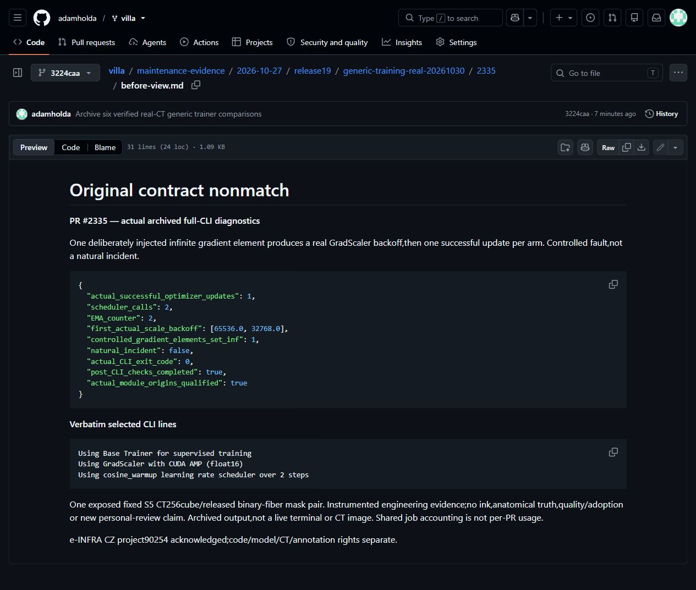
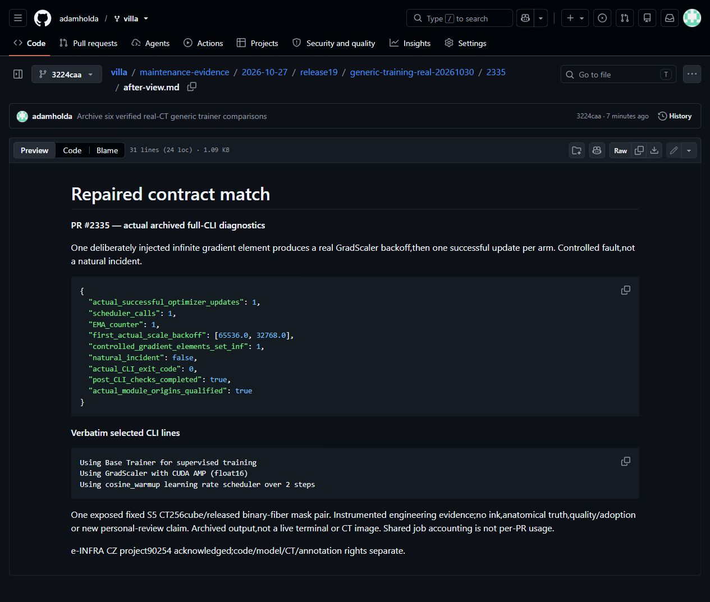
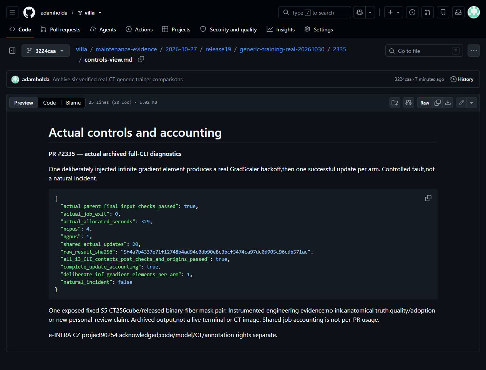

# PR #2335: Disclosed controlled GradScaler overflow and actual consumers

These are selected actual archived diagnostic fields and verbatim safe lines from completed CLI logs. Screenshots of these pages are archived-output browser captures,not live terminal sessions or CT pixels. The original can exit0 while failing the stated behavioral contract. Values are unmodified;paths/weights/arrays stay private.

See before.json,after.json,controls.json and their actual CLI line excerpts.

## Actual archived-output browser captures

[Original view](before-view.md) · [Repaired view](after-view.md) · [Controls view](controls-view.md). The original CLI exited0;the stated nonmatch is behavioral. Captures are unmodified and retain the archived-output scope.
