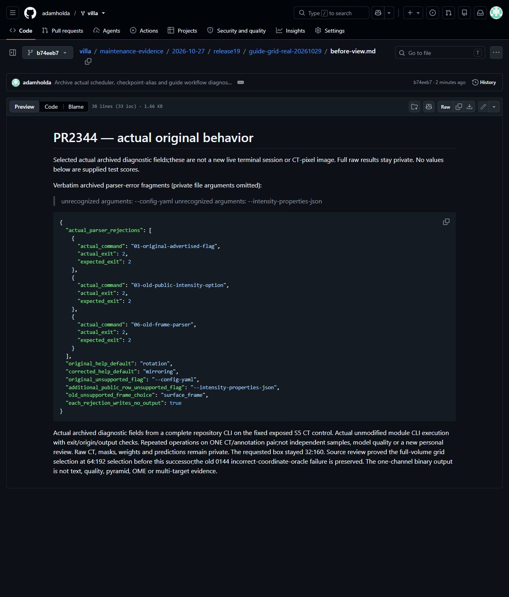
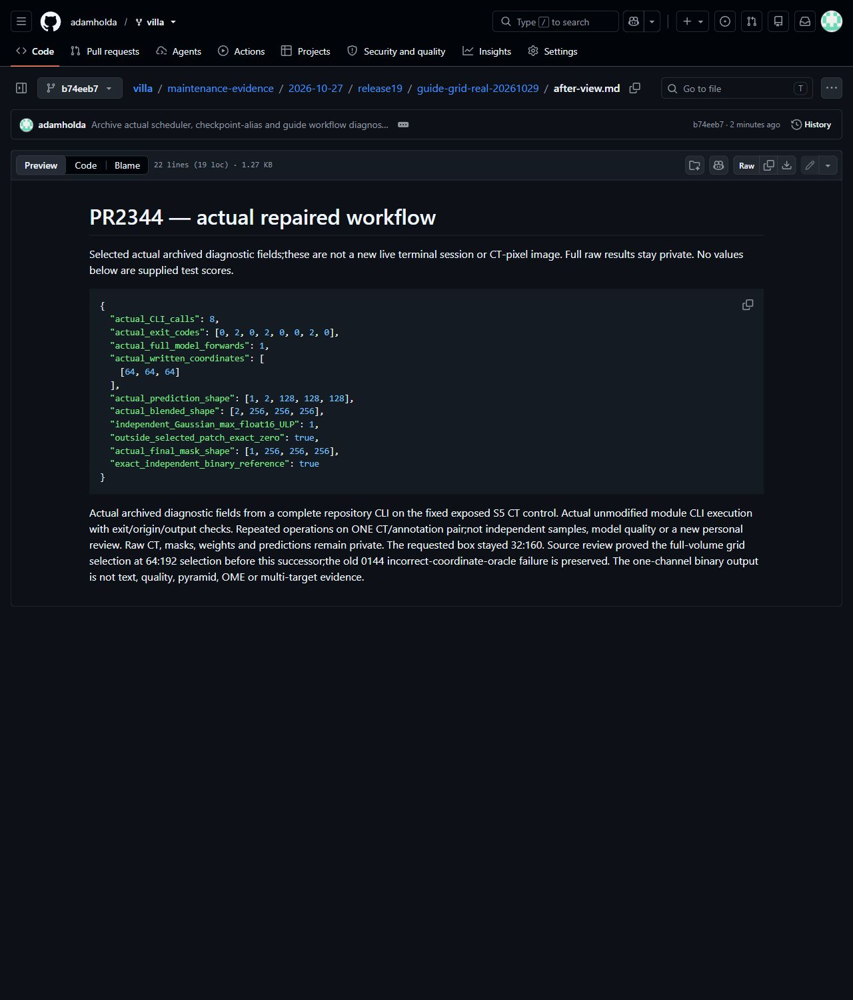
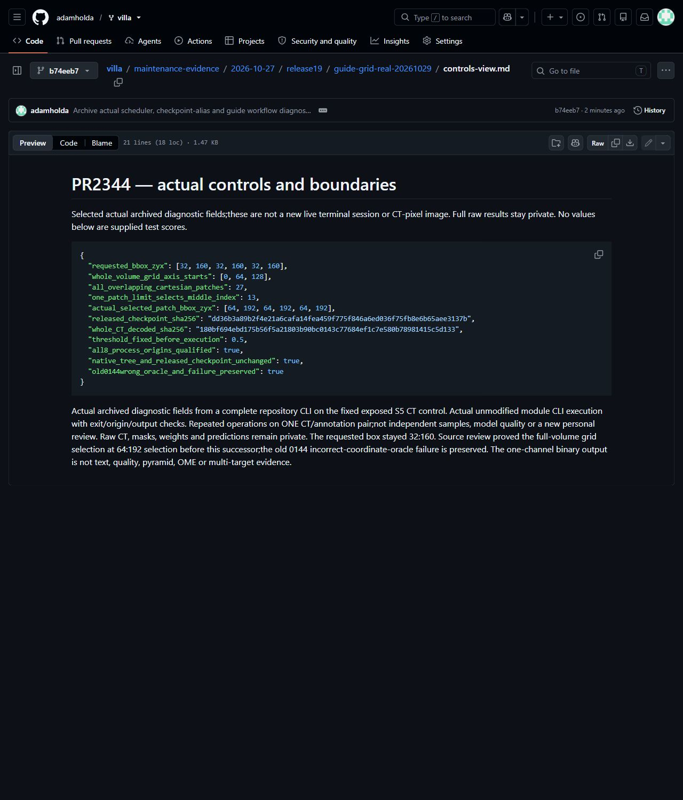

# Actual released-model predict blend finalize guide

Existing [PR2344](https://github.com/ScrollPrize/villa/pull/2344) at production head `4e5f4a382d0b0e857b42aa40efe84950b772e11c`.

Actual archived diagnostic fields from a complete repository CLI on the fixed exposed S5 CT control. Actual unmodified module CLI execution with exit/origin/output checks. Repeated operations on ONE CT/annotation pair;not independent samples, model quality or a new personal review. Raw CT, masks, weights and predictions remain private. The requested box stayed 32:160. Source review proved the full-volume grid selection at 64:192 selection before this successor;the old 0144 incorrect-coordinate-oracle failure is preserved. The one-channel binary output is not text, quality, pyramid, OME or multi-target evidence.

[Actual original fields](before-view.md) · [Actual repaired fields](after-view.md) · [Actual controls](controls-view.md) · [Actual selected records](actual-records.json). Actual unmodified browser captures of the published diagnostic views:

All three captures were visually reviewed for legibility and privacy; bytes and Git blob hashes are recorded in [the capture manifest](screenshot-manifest.json).

Computational resources were provided by the e-INFRA CZ project(ID90254),supported by the Ministry of Education,Youth and Sports of the Czech Republic. VillaMIT/model/CT/annotation rights and attribution remain separate.
