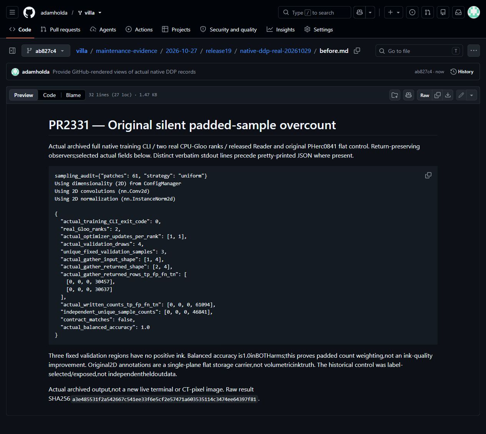
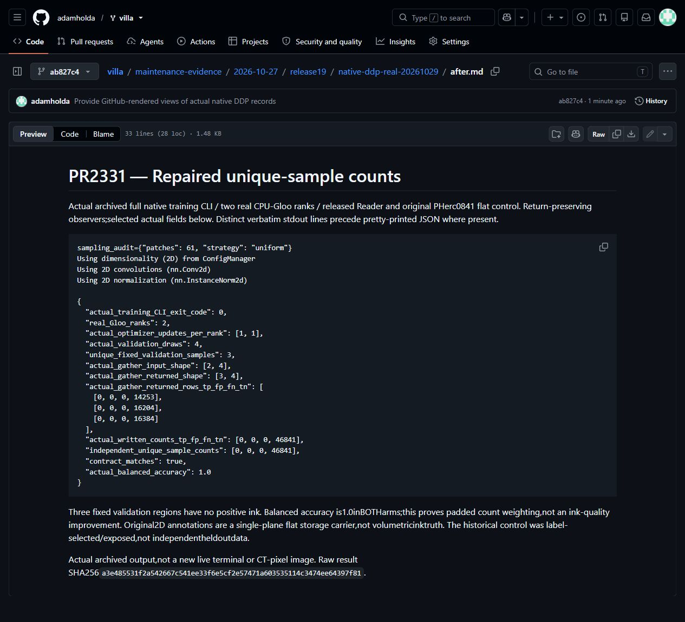
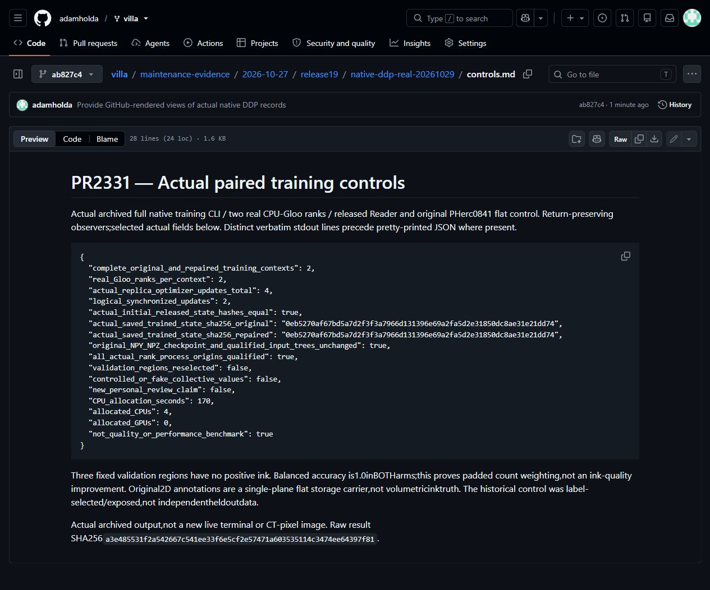

# PR2331: actual full native trainer and padded Gloo validation

The original full trainer silently counts a padded validation sample twice. On the fixed original PHerc0841 flat control, actual written TP/FP/FN/TN is `[0,0,0,61094]`; the repaired existing PR2331 produces `[0,0,0,46841]`, exactly the three-unique-sample oracle. The duplicate is14253reviewed nonink pixels. All three fixed validation regions contain no positive ink; balanced accuracy is1.0inBOTHarms. No positive-ink/quality improvement or region reselection is claimed.

Two actual `torch.distributed.run`/CPU-Gloo ranks per arm invoke the complete native `training.main` parser, typed TrainingRequest, InkDataset, released Reader, AdamW, repository flat loss, backward/accumulation, actual validation and checkpoint writer. There is one actual underlying optimizer step per rank:four replica step calls/two synchronized updates over the two arms. Actual Accelerate batch2sharding pads3items to4draws. Original aggregate rows[1,4]perrank gather to[2,4];repaired per-sample rows[2,4]gather to[3,4]. Actual per-sample prediction/target/valid-mask hashes identify and verify the duplicate;no collective values or scores are supplied. Loaded and trained state controls are exact between arms.

This is **instrumented complete native trainer/CLI evidence**. Observers preserve actual optimizer,restore,validation and collective returns. It is not an uninstrumented human terminal,DDP performance benchmark,whole-portfolio compliance or training-quality result. The original whole28x1024x1024surface control and published2Dink/reviewed masks use a single central storage plane solely to preserve the native flat projection contract;this is not volumetric ink truth or independent registration. The old control was originally label-selected/exposed historically. No raw data,model payloads or prediction pixels are published.

- [Original actual selected fields](original-selected.json),[original capture view](before-view.html).
- [Repaired actual selected fields](repaired-selected.json),[repaired capture view](after-view.html).
- [Actual paired controls](controls-selected.json),[controls capture view](controls-view.html).
- [Selected verbatim actual CLI stdout](verbatim-native-cli-excerpts.txt).

Source:current main8ff06f7620dcb663ed327028dbb8a0cf7e9a8198's416non-fiber source blobs match the pinned existing environment. Public2331head5093193dd365e1744e8a3e261f84bc91d30d3cf9/trainblob b02afd0f9588db6ad21efd5bed43ea47bfcb84ae is unchanged;only that exact train file changes between original/repaired source contexts. Python3.14.0,Torch2.12.1,Accelerate1.14.0,NumPy2.4.6. This is not a fresh installer,full current repository or excluded fiber package proof.

One completed allocation:170seconds x4CPU/0GPU.20UTF8files111346bytes collected once/hash-checked. Raw result SHA256 `a3e485531f2a542667c541ee33f6e5cf2e57471a603535114c3474ee64397f81`. Original input/checkpoint/constructed trees and all four actual process origins pass their final checks. Repeated draws/operations are not independent data examples. Code/execution/evidence preparation used Codex under Adam's bounded authorization;the adopted workflow motivation remains separate. No fresh personal-review attestation is inferred. e-INFRA CZ90254;VillaMIT,Reader,CT and annotation rights are separate. Original checked review and original historical CPU evidence remain preserved.

## Actual unmodified captures

Capture source: [original](before.md),[repaired](after.md),[controls](controls.md) at view commit ab827c4703ddbf22134bc606d0170e8c0d03bc23. Browser JPEG bytes are unmodified;no pixel editing or generated terminals. [Screenshot manifest](screenshot-manifest.json).
