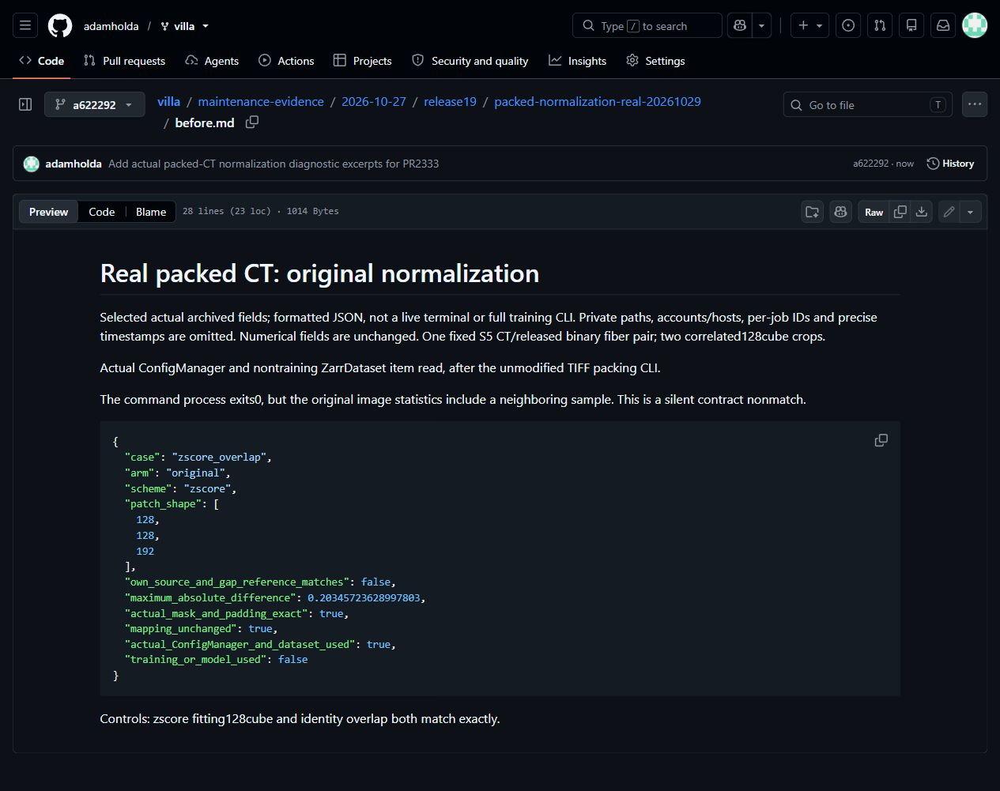
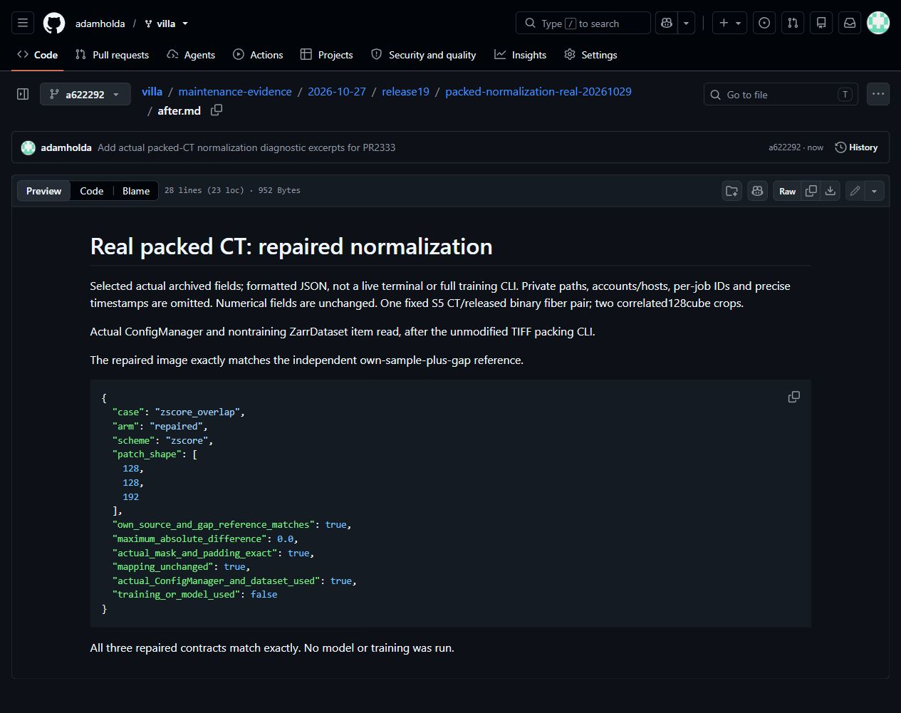
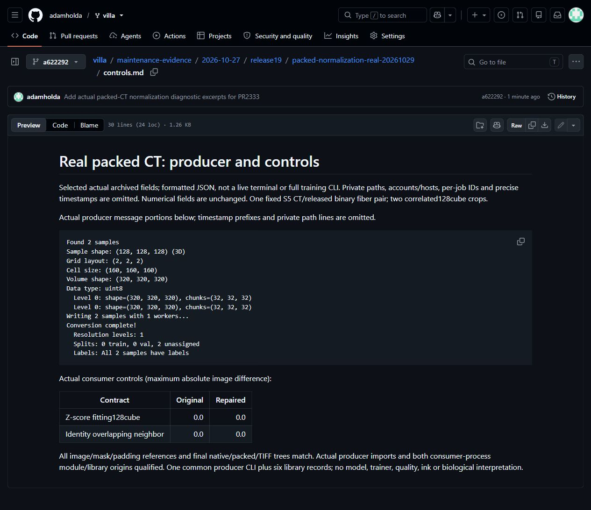

# Real packed-CT normalization,29October2026

Existing [PR2333](https://github.com/ScrollPrize/villa/pull/2333), production head5c27bc7c995179f98ce985ac7b9bdc3ac1e95bed unchanged. Actual unchanged TIFF packer emitted the sparse mapping for two fixed128cubes from the whole S5CT/released Dataset004 binary fiber mask. Origins(0,0,0)/(128,128,128),gap32/chunk32,onelevel/oneworker; no label search,synthetic intensity or mapping edits.

Actual ConfigManager/nontraining ZarrDataset consumers: original zscore-overlap differs from an independent own-sample-plus-gap reference by0.20345723628997803;original fitting/identity controls both exact. Repaired all3contracts exact,maxdiff0. Exact image/mask/padding references,final native/packed/TIFF preservation and actual producer/consumer import origins pass. This is one common producer CLI plus six nontraining library records on one correlated pair,not six independent samples or full trainingCLIcalls. It does not establish trainer/model/quality/ink/biological results. Annotation-derived fiber classes are not dense reviewed negative truth or anatomical instances.

The three Markdown views show selected actual archived diagnostic fields and producer message portions,with private paths/account/host/per-job identifiers/precise timestamps omitted. Numeric values are unchanged. Screenshots are unmodified browser captures of these public excerpts,not raw CT pixels,a live terminal or generated graphics. Original raw logs/arrays remain private;the manifest preserves raw hashes and selection details. Later supplements are not presumed personally reviewed. Old generated0077image remains historical.

207allocated seconds x1CPU/0GPU. Same13official pinned producer artifacts were deployed to scratch under existingCPython3.13.5 without pip/ensurepip/system install;consumer uses the verified existingCPython3.14 archive. Separate failed0143setup remains preserved. This is not a fresh full-repository installer proof. Credit original packer/normalizer and giorgioangel802. e-INFRA CZ project90254;VillaMIT,CT and annotation rights separate. No acceptance,contribution-count or prize claim.

[Capture hashes and sizes](screenshot-manifest.json)
