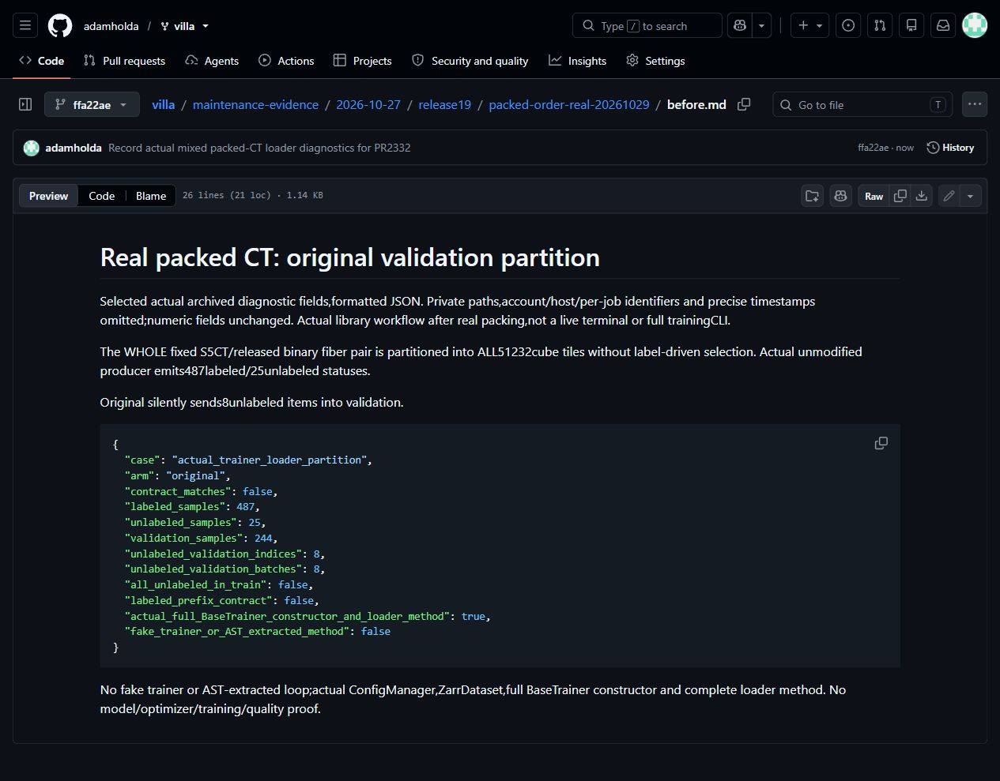
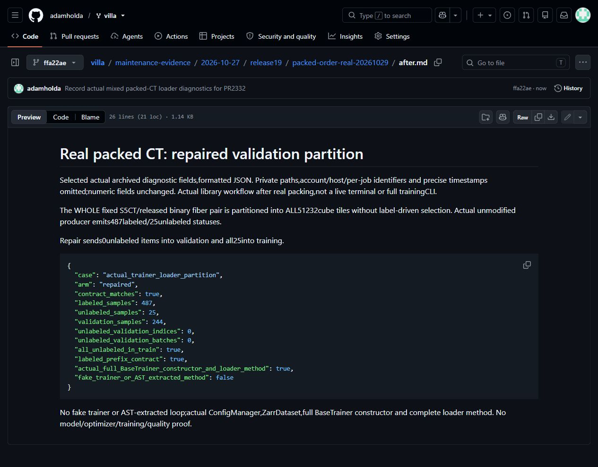
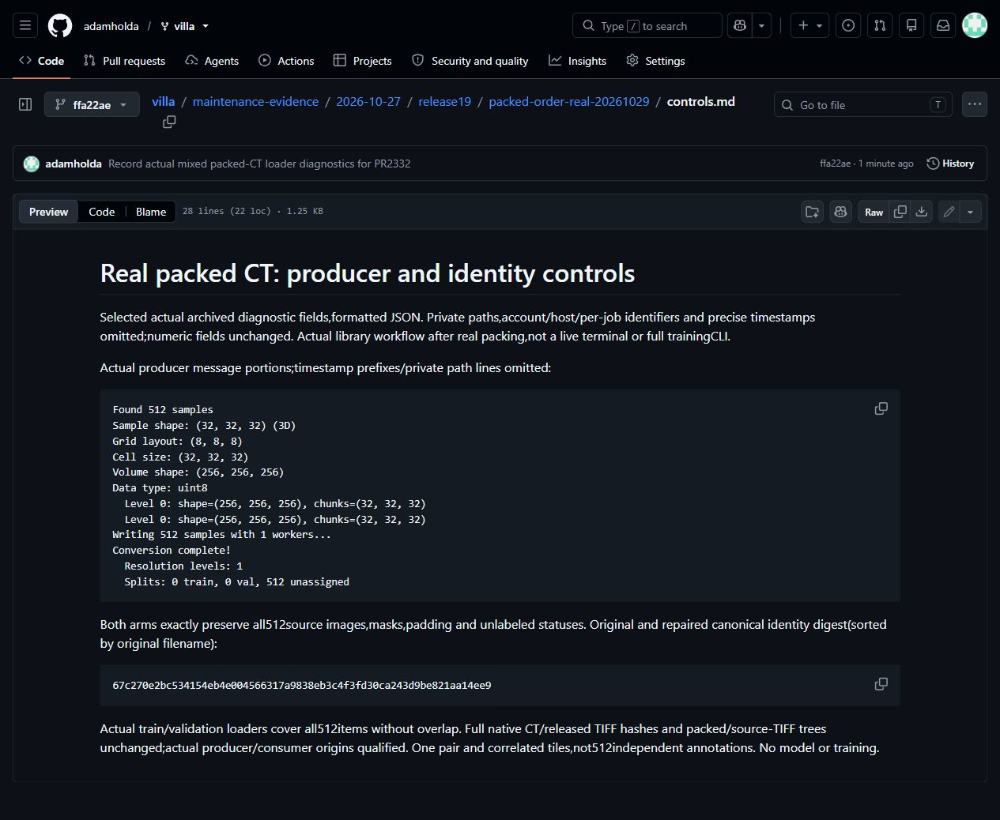

# Actual mixed packed CT and trainer loader,29October2026

Existing [PR2332](https://github.com/ScrollPrize/villa/pull/2332),head9c071c0ec3ab6a76663a4bbf888e8a09ef9c969a unchanged. The ENTIRE fixed256cube S5CT/released binary fiber pair was partitioned into ALL512nonoverlapping32cubes in lexicalZYXorder. Actual unchanged TIFF producer(gap0/chunk32/onelevel/oneworker)naturally emitted487labeled/25unlabeled statuses. No annotation selection,reordering,forged zero masks or mapping edits.

Actual ConfigManager,ZarrDataset,full BaseTrainer constructor and complete DataLoader split:original silently placed8unlabeled items among244validation items;repair placed0there and all25in training. Every512direct source image/mask/padding/status check per arm is exact;canonical identities and final native/packed/TIFF trees unchanged. Actual loaders cover all512items without overlap. External RNGseed0,split0.5,batch1/workers0/normalizationnone. Actual producer and both consumer-process origins qualified. Four compound records(one original nonmatch/one identitycontrol/two repairedmatches),not four independent samples or old unittest counts. No fake trainer namespace,AST-extracted method,model constructor,forward,optimizer,training,DDP or quality result. All tiles are correlated parts of one pair. Released allzero annotation tiles are producer-unlabeled,not dense reviewed ink-negative truth or anatomical instances.

Three unmodified browser captures show selected actual diagnostic fields and producer message portions;private filesystem paths,account/host/per-job identifiers/precise timestamps omitted before capture. Numeric fields unchanged. Not a live terminal,raw CT pixels or generated graphics. Raw logs/arrays remain private;manifest preserves raw hashes/selection. Original generated image remains historical;new supplement is not presumed personally reviewed.

215allocated seconds x1CPU/0GPU,final/reconciled. Same13pinned producer artifacts deployed to scratch under existingCPython3.13.5;verified existingCPython3.14consumer archive/sharedbase. No pip/ensurepip/system install or persistent environment change;not a full new repository/installer proof. Credit original producer/trainer/prior authors. e-INFRA CZ90254;VillaMIT/CT/annotation rights separate. No acceptance,prize or blanket contribution-rule claim.

[Capture hashes/sizes](screenshot-manifest.json)
