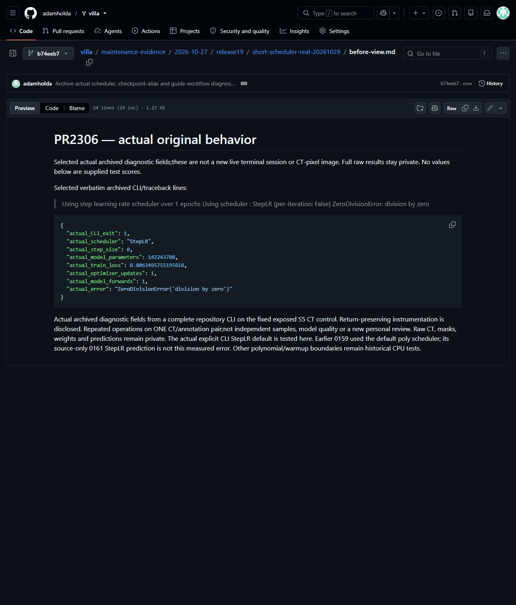
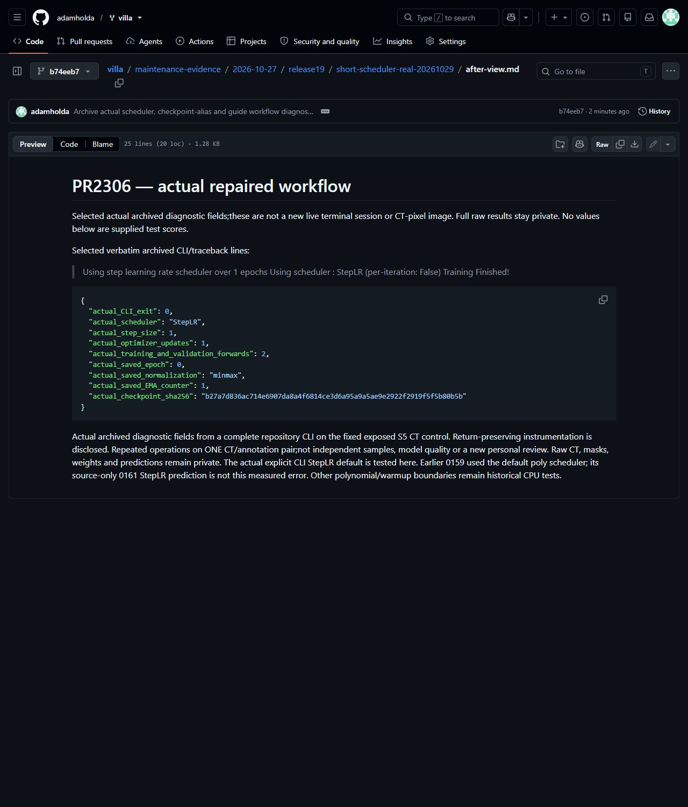
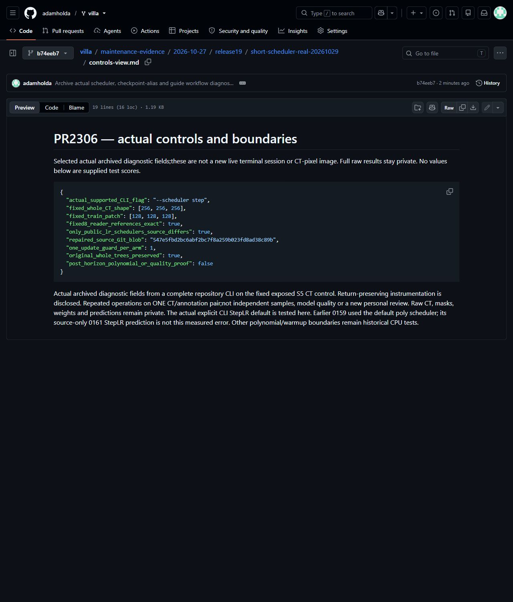

# Actual real-CT short-run scheduler CLI

Existing [PR2306](https://github.com/ScrollPrize/villa/pull/2306) at production head `ab46b8b0af6b6b1bf39a7e3ea85ae5e18cd2ff01`.

Actual archived diagnostic fields from a complete repository CLI on the fixed exposed S5 CT control. Return-preserving instrumentation is disclosed. Repeated operations on ONE CT/annotation pair;not independent samples, model quality or a new personal review. Raw CT, masks, weights and predictions remain private. The actual explicit CLI StepLR default is tested here. Earlier 0159 used the default poly scheduler; its source-only 0161 StepLR prediction is not this measured error. Other polynomial/warmup boundaries remain historical CPU tests.

[Actual original fields](before-view.md) · [Actual repaired fields](after-view.md) · [Actual controls](controls-view.md) · [Actual selected records](actual-records.json). Actual unmodified browser captures of the published diagnostic views:

All three captures were visually reviewed for legibility and privacy; bytes and Git blob hashes are recorded in [the capture manifest](screenshot-manifest.json).

Computational resources were provided by the e-INFRA CZ project(ID90254),supported by the Ministry of Education,Youth and Sports of the Czech Republic. VillaMIT/model/CT/annotation rights and attribution remain separate.
