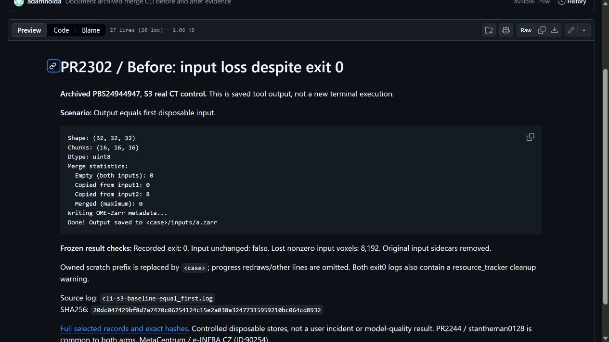
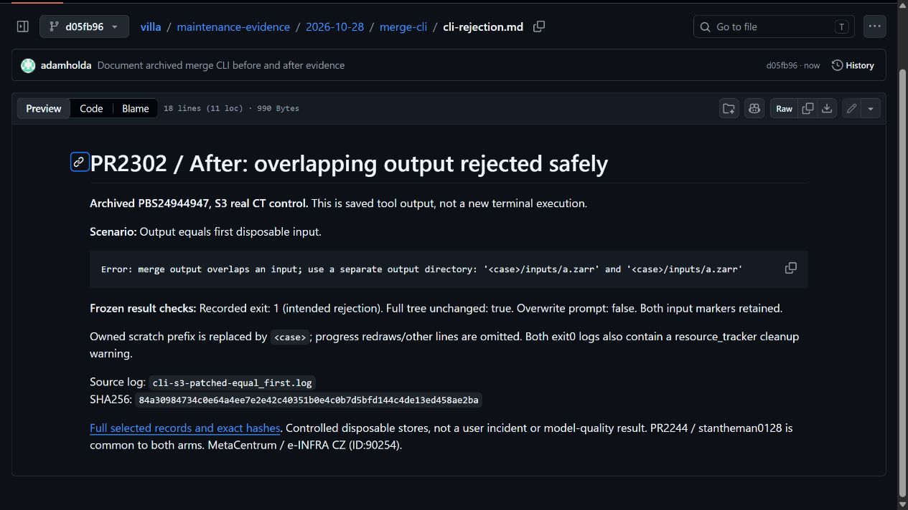
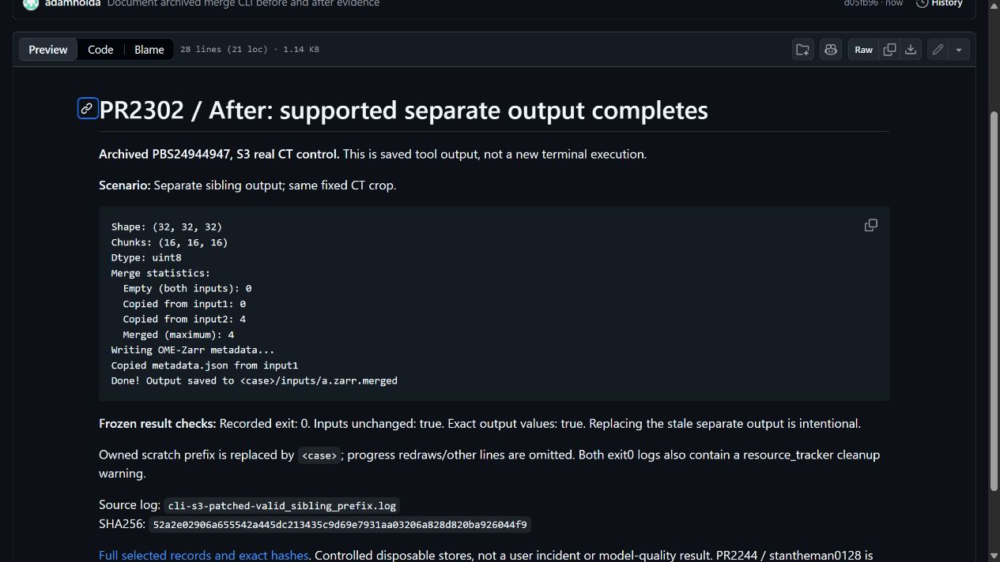

# Merge: direct archived CLI evidence

PBS24944947, existing completed real-CT comparison. No new execution. These screenshots are browser captures of saved CLI excerpts and recorded checks, not live terminal images. Scratch paths are normalized to `<case>`; progress redraws and other lines are omitted. The source logs and frozen result hashes are recorded in [cli-records.json](cli-records.json). The complete comparison remains in the original linked PR evidence.

## Before

```text
Shape: (32, 32, 32)
Chunks: (16, 16, 16)
Dtype: uint8
Merge statistics:
  Empty (both inputs): 0
  Copied from input1: 0
  Copied from input2: 8
  Merged (maximum): 0
Writing OME-Zarr metadata...
Done! Output saved to <case>/inputs/a.zarr
```

Recorded checks: `{"arm": "baseline", "case": "equal_first", "changed_entries": ["inputs/a.zarr/0/.zarray", "inputs/a.zarr/0/0/0/0", "inputs/a.zarr/0/0/1/0", "inputs/a.zarr/0/1/0/0", "inputs/a.zarr/0/1/1/0"], "elapsed_seconds": 7.197929716669023, "exit_code": 0, "fixture": "s3", "input_markers_present": [false, true], "inputs_unchanged": false, "intended_rejection": false, "log_sha256": "20dc047429bf8d7a7470c06254124c15e2a038a32477315959210bc064cd8932", "lost_nonzero_input_voxels": 8192, "output_alias_preserved": null, "overwrite_prompt": true, "removed_entries": ["inputs/a.zarr/keep.txt", "inputs/a.zarr/metadata.json"], "tree_unchanged": false}`

## Rejection

```text
Error: merge output overlaps an input; use a separate output directory: '<case>/inputs/a.zarr' and '<case>/inputs/a.zarr'
```

Recorded checks: `{"arm": "patched", "case": "equal_first", "changed_entries": [], "elapsed_seconds": 3.64313653903082, "exit_code": 1, "fixture": "s3", "input_markers_present": [true, true], "inputs_unchanged": true, "intended_rejection": true, "log_sha256": "84a30984734c0e64a4ee7e2e42c40351b0e4c0b7d5bfd144c4de13ed458ae2ba", "output_alias_preserved": null, "overwrite_prompt": false, "removed_entries": [], "tree_unchanged": true}`

## Success

```text
Shape: (32, 32, 32)
Chunks: (16, 16, 16)
Dtype: uint8
Merge statistics:
  Empty (both inputs): 0
  Copied from input1: 0
  Copied from input2: 4
  Merged (maximum): 4
Writing OME-Zarr metadata...
Copied metadata.json from input1
Done! Output saved to <case>/inputs/a.zarr.merged
```

Recorded checks: `{"arm": "patched", "case": "valid_sibling_prefix", "changed_entries": [], "elapsed_seconds": 6.728039141744375, "exact_values": true, "exit_code": 0, "fixture": "s3", "input_markers_present": [true, true], "inputs_unchanged": true, "intended_rejection": false, "log_sha256": "52a2e02906a655542a445dc213435c9d69e7931aa03206a828d820ba926044f9", "output_alias_preserved": null, "output_sha256": "589b8f30ec3e74496d4aa38251e39c02e4aaedabf687e45e2113a2e9cdd21562", "overwrite_prompt": true, "removed_entries": ["inputs/a.zarr.merged/stale.txt"], "tree_unchanged": false}`

The baseline exits0 while losing8192 nonzero input voxels; the same unsupported alias rejects safely after the guard. A supported separate-output run exits0 with exact CT values and unchanged inputs. A resource_tracker cleanup warning also exists in both exit0 logs; it is not hidden as a new clean-environment claim. These are controlled disposable copies, not an observed human data-loss incident. This supplement does not establish human-written workflow motivation or personal review of this later capture. Common Zarr3 dependency PR2244 by stantheman0128 remains credited.

AI assistance supported implementation, validation orchestration and evidence preparation. Computational resources were provided by the e-INFRA CZ project (ID:90254), supported by the Ministry of Education, Youth and Sports of the Czech Republic. Scan data rights and Villa MIT code rights remain separate.


## Actual browser captures







[Capture hashes and source commit](screenshot-manifest.json). These later28October views do not imply a new personal review of evidence by the author.
