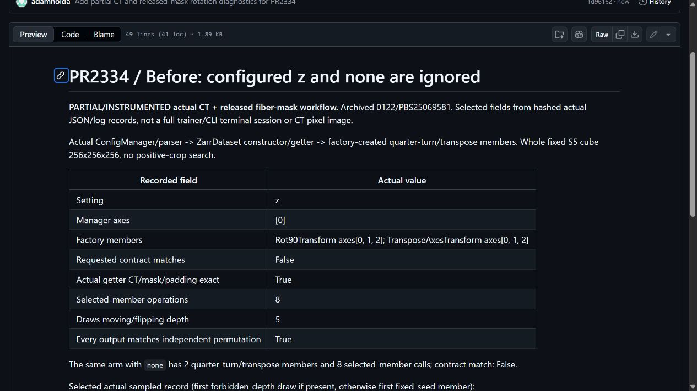
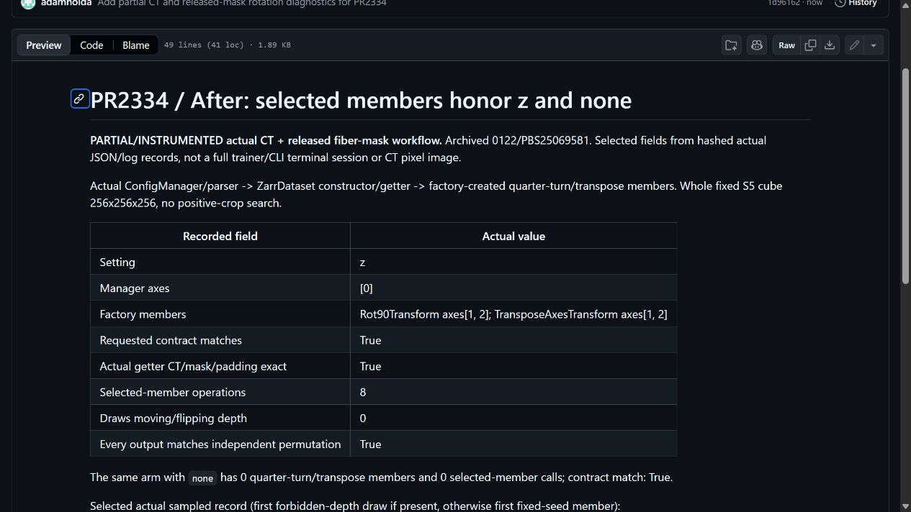
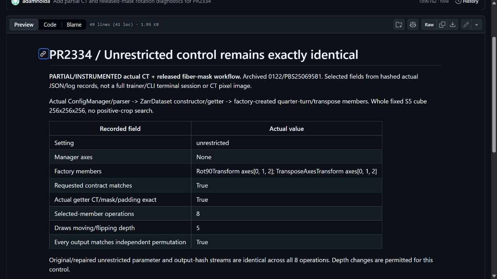

# Configured rotation members on real CT and a released annotation mask

Existing2334/protocol0122/PBS25069581 completed six configured dataset/factory records: original 2 nonmatches / 1 control, repaired 3 matching contracts. All 40 selected actual image/fiber-target/padding operations match independent NumPy references. Original z moves/flips depth in 5 of 8 selected draws;repaired z in 0 of 8. Original none still creates both members and changes the CT;repaired none creates neither. Unrestricted 8-operation streams remain identical. Final 96s x1 CPU/0 GPU, one run, no retry. These are repeated operations on one whole S5 pair,not 40 independent samples/tests or another fix.

[Original diagnostic](diagnostic-before.md) · [Repaired diagnostic](diagnostic-after.md) · [Unchanged control](diagnostic-control.md) · [Exact records/hashes](selected-records.json) · [Exact executed child for audit](executed-child.py) · [Frozen scope/oracles](frozen-protocol.md). The audit child needs the pinned production context and data specification; it is not a standalone install/full-trainer recipe. Captures are unmodified browser views of selected actual records,not live terminals,raw tool error screenshots or CT pixels.

**Partial/instrumented scope:** actual ConfigManager/parser/ZarrDataset loading/factory, followed by selected actual quarter-turn/transpose members. The composed stochastic pipeline is bypassed for loading, restored, and its selected members executed with a transparent observer. No full training, model, DDP, intensity/low-resolution execution, other dataset constructors, physical registration, anatomical instance or ink-quality claim. Binary 0/1 labels come from official Dataset004; zero is not asserted human-reviewed ink-negative truth. Raw data and constructed inputs remain private/unchanged. Existing 9-method CPU evidence is historical and was not rerun.

Source closure 416 current non-fiber files matches the existing environment; the exact four-file 0081 patch matches existing 2334 head 0f9ba937. The existing allowed-axes API and other work by bruniss (#509/#666) remain credited; other inspected search results are merged/distinct, not an exhaustive novelty proof. No new human-written relevance, personal review, maintainer acceptance or award is inferred. AI assistance supported test preparation, orchestration, analysis and drafting. Computational resources were provided by e-INFRA CZ project (ID 90254), supported by the Ministry of Education, Youth and Sports of the Czech Republic. Villa MIT and CT/annotation rights/EduceLab-Scrolls attribution remain separate.

## Selected diagnostic captures

[Image hashes and capture scope](screenshots.json). These are partial instrumented records,not a full human CLI/training demonstration.
