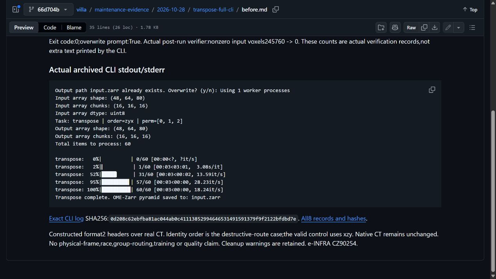
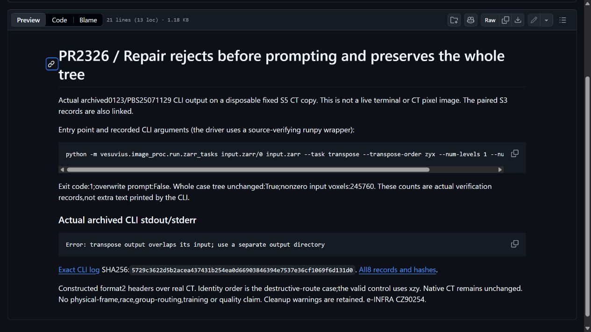
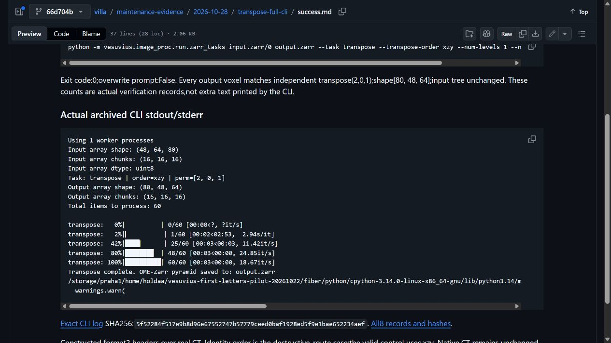

# PR2326 actual full CLI alias proof

0123/PBS25071129 completed exactly8fullCLI calls once:2original identity-order alias calls exit0 while replacing245760nonzero source voxels with0 per disposable S3/S5copy;2repaired calls reject before the overwrite prompt and preserve the complete trees;4valid xzy transposes remain exact. Native inputs unchanged.66s x1CPU/0GPU,exit0,no retry. This supplements existing2326 without changing its production head.

[Original output](before.md) · [Repaired rejection](rejection.md) · [Supported success](success.md) · [All8 records/source/input/log hashes](selected-records.json).

Screenshots are unmodified browser captures of actual archived CLI output plus separately labeled actual verifier measurements,not live terminal sessions or CT pixels. Original destructive routes use zyx identity to isolate overwrite behavior;valid controls use xzy and independent whole-array permutations. Reused real crops have constructed format2 headers;no physical registration/group routing/higher-pyramid/race or training/quality claim. Old0114generated methods and prepare-only hazard records remain unchanged history. New supplement is not presumed personally reviewed and does not create human-written relevance.

Current main39a8cf3a non-fiber closure416files matches existinge2254ebe environment;no fresh installer/full-repository proof. Common creator work from1682/kadenpool is credited;our only production delta is the existing0045guard. AI assisted preparation,orchestration,analysis and drafting. Computational resources were provided by the e-INFRA CZ project(ID90254),supported by the Ministry of Education,Youth and Sports of the Czech Republic. Villa MIT and scan/EduceLab-Scrolls rights remain separate.

## Archived CLI captures

[Capture hashes](screenshots.json). Terminal output and post-run measurements are labeled separately.
