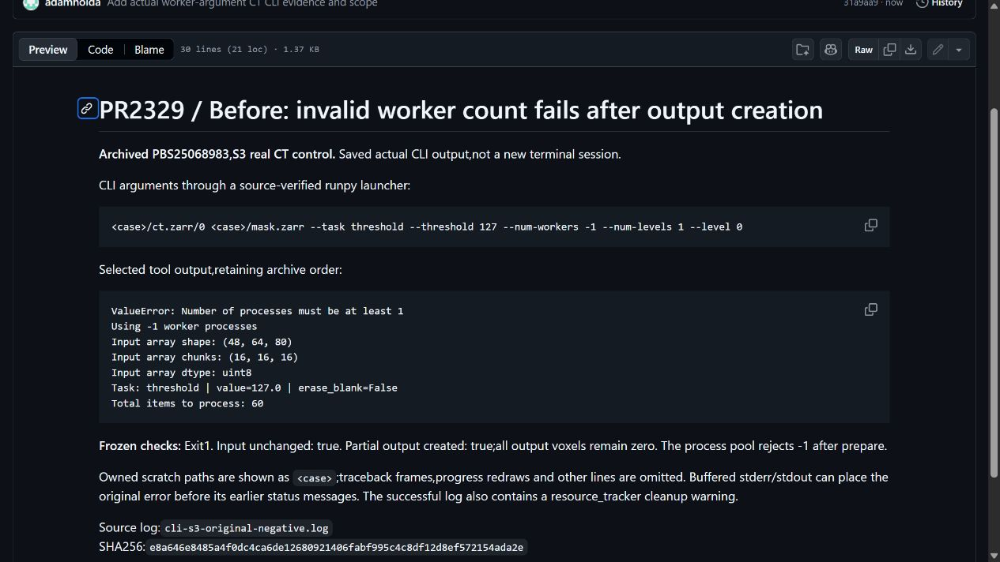
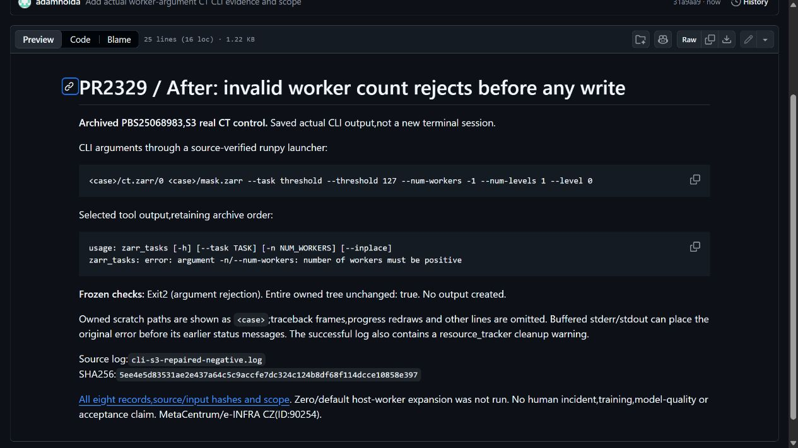
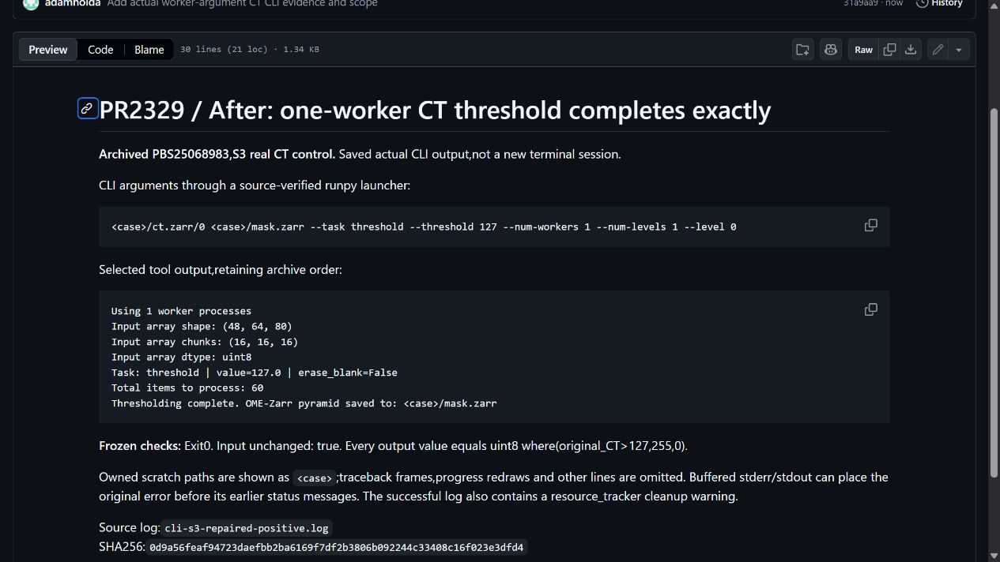

# Worker argument guard: actual real-CT CLI evidence

Existing PR2329/protocol0117/PBS25068983 completed once. All8 fixed records match their oracles:2original late Pool errors/partial outputs,2repaired early argument rejections,4valid exact one-worker masks. Inputs and native CT bytes remain unchanged. One CPU72seconds,0GPU,final/reconciled. These are controlled routes on two CT crops,not8 regression methods or independent incidents.

[Before](cli-before.md) · [Repaired argument rejection](cli-rejection.md) · [Valid one-worker completion](cli-success.md) · [Exact selected records/log hashes](selected-records.json). The images are unmodified browser captures of these actual archived tool excerpts,not live terminal captures or CT pixels.

Only the existing positive parser helper/type changes. Zero/default expansion is not run;selector/quota/affinity behavior is unchanged. Source closure416non-fiber current-main files matches within the existing environment;no fresh installer/full-repository,training,AMP,DDP,model-quality,adoption or award proof. Successful logs also contain a resource_tracker cleanup warning. Human-written workflow relevance/personal review of this supplement remain separate.

AI assistance supported implementation,validation orchestration,analysis and evidence preparation. Computational resources were provided by the e-INFRA CZ project(ID:90254),supported by the Ministry of Education,Youth and Sports of the Czech Republic. Villa MIT and CT/data rights/EduceLab-Scrolls attribution remain separate.

## Actual browser captures

[Capture hashes/source commit](screenshot-manifest.json). These later views do not imply a new personal author review.
